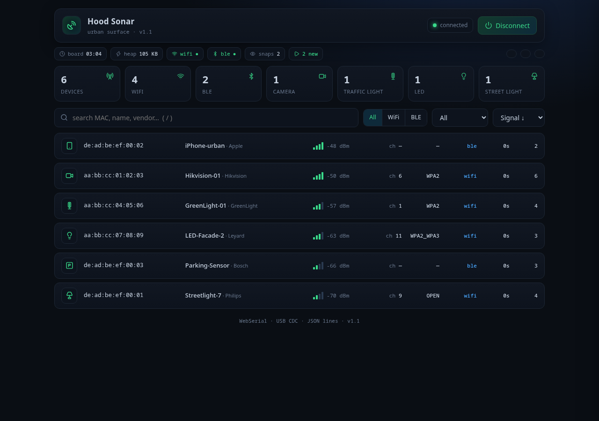
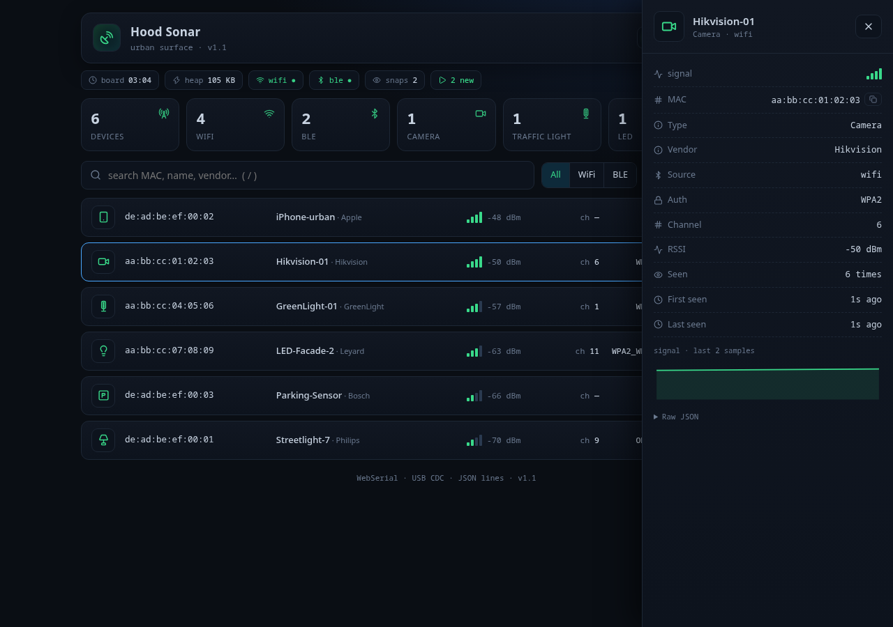

# Hood Sonar

<div align="center">

[](LICENSE)
[](https://github.com/espressif/esp-idf)
[](https://www.espressif.com/en/products/socs/esp32-c3)
[](tests/run.sh)
[](web/dashboard.html)

**A neighborhood sonar for urban surfaces.** An ESP32-C3 continuously scans the
radio air (Wi-Fi + BLE), classifies nearby devices (CCTV cameras, traffic lights,
LED displays, street lights, parking sensors, phones…) directly on the board, and
emits **JSON over USB-Serial/JTAG**. A single-file dashboard consumes it via
**WebSerial** and renders everything in real time.



</div>

## Features

**Firmware** (ESP-IDF v5.3, no PSRAM — 400 KB SRAM):

- **Wi-Fi** active scan (async, every ~2.5 s) and continuous **BLE discovery**
  (NimBLE) running in parallel
- **3-layer on-board classification**: OUI (343 vendors) → SSID/name keywords →
  BLE GATT service UUIDs
- Device table with dedup by MAC+source, best-RSSI tracking and oldest eviction (128 slots)
- **JSON lines** over USB CDC: `hello` (boot) · `snap` (every ~2 s) · `stat`
  (board health, every ~10 s)
- No HTTP server on the board: all rendering lives in the browser (saves ~400 KB SRAM)

**Dashboard** (`web/dashboard.html`, single file, **zero external dependencies**):

- **Inline SVG icons** (Lucide, ISC) — no CDNs, no webfonts: works on `file://`,
  offline and on GitHub Pages
- Board health statusbar: uptime, heap, live Wi-Fi/BLE radios, snapshots, corrupt lines
- Search (`/`), source filters (WiFi/BLE), type filters, sort by signal/recency/type
- **Detail drawer** with signal sparkline (60-sample history), copy MAC, raw JSON
- Live pause (key `p`), **CSV/JSON export**, highlight for newly seen devices
- Auto port reconnect (up to 6 attempts, no interaction needed)
- XSS-safe: SSIDs/BLE names are attacker-controlled and always escaped



## Hardware

| | |
|---|---|
| Board | ESP32-C3 (native USB-Serial/JTAG, VID:PID `303a:1001`) |
| Flash | 4 MB (app ~950 KB, 8% free) · 400 KB SRAM, no PSRAM needed |
| Port | `/dev/ttyACM0` (Linux) or equivalent |

## Quick start

```bash
# 1) Firmware: build and flash
source ~/esp/esp-idf/export.sh        # once per shell
cd firmware
idf.py set-target esp32c3             # first time only
idf.py build
idf.py -p /dev/ttyACM0 flash monitor  # monitor: Ctrl-] to exit

# 2) Dashboard: open in Chrome/Edge
web/dashboard.html                    # double click (file:// works)
```

In the dashboard press **Connect**, pick `/dev/ttyACM0`, and devices appear live
(snapshot every ~2 s). The serial port is exclusive: don't use `idf.py monitor`
and the dashboard at the same time.

> **Demo without hardware**: open the dashboard (or the Pages URL) and run
> `window.__mock = true` in the browser console, then press **Connect**. It injects
> a `hello` + 2 `snap` messages with sample urban devices.

## JSON protocol (USB CDC)

JSON lines, one per line (`\n`). Lines that don't parse are system logs and get ignored.

**`hello`** — on boot:

```json
{"t":"hello","id":"18:8b:0e:39:8d:48","fw":"v1.1","heap":107944,"wifi":1,"ble":1}
```

**`snap`** — every ~2 s, full table snapshot:

```json
{"t":"snap","d":[
  {"mac":"aa:bb:cc:01:02:03","type":"camera","name":"Hikvision-01","rssi":-52,
   "ch":6,"auth":"WPA2","vendor":"Hikvision","src":"wifi","last":1234,"cnt":5}
],"n":1}
```

**`stat`** — every ~10 s, board health: `{"t":"stat","up":20324,"heap":107824,"devs":8,"wifi":1,"ble":1}`

| field | type | description |
|---|---|---|
| `mac` | string | MAC address (6 hex octets) |
| `type` | string | category (table below) |
| `name` | string | SSID / BLE name (≤32) |
| `rssi` | int | signal in dBm (better = less negative) |
| `ch` | int | Wi-Fi channel (0 on BLE) |
| `auth` | string | `OPEN` `WEP` `WPA` `WPA2` `WPA3` `WPA2_WPA3` |
| `vendor` | string | vendor from OUI (≤15) |
| `src` | string | `wifi` or `ble` |
| `last` | int | ms since boot (last-seen) |
| `cnt` | int | times seen |

### Categories (`type`)

| | | | |
|---|---|---|---|
| 📷 `camera` CCTV | 📱 `phone` phones | 🖨 `printer` printers | 📶 `hotspot` hotspots |
| 💡 `led` LED banners | 🪧 `signage` signage | 🏢 `facade` facades | 📺 `screen` screens |
| 🚦 `traffic` traffic lights | 🌃 `streetlight` street lights | 🅿️ `parking` parking | 📡 `router` routers |
| ⚙️ `iot` generic IoT | 🔵 `ble` unclassified BLE | ❔ `unknown` | |

## Dashboard on GitHub Pages

The dashboard is published to **GitHub Pages** automatically on every push to
`main` (workflow `.github/workflows/pages.yml`):

```
https://<user>.github.io/<repo>/
```

One-time setup: **Settings → Pages → Build and deployment → Source = GitHub Actions**.
Since the page is served over HTTPS, the Connect button works just like locally, and
the mock mode lets you try it from any device without the board.

## Repository layout

```
hood-sonar/
├── firmware/
│   ├── CMakeLists.txt, sdkconfig.defaults   # project config (sdkconfig is generated)
│   └── main/
│       ├── scanner_common.[ch]   # types (device_t, cat_t, src_t, auth_t)
│       ├── scanner_oui.[ch]      # OUI table (343 vendors)
│       ├── scanner_classify.[ch] # classification (name/uuid/OUI)
│       ├── scanner_table.[ch]    # device table (dedup, best-rssi, evict)
│       ├── scanner_wifi.[ch]     # Wi-Fi scanning (esp_wifi)
│       ├── scanner_ble.[ch]      # BLE scanning (NimBLE)
│       ├── scanner_proto.[ch]    # JSON (hello/snap/stat)
│       └── scanner_main.c        # init + loop (scan 2.5 s · snap 2 s · stat 10 s)
├── web/                          # single-file dashboard + redirect + .nojekyll
├── tests/                        # host tests (plain gcc, no hardware) + run.sh
├── docs/                         # screenshots
└── .github/workflows/            # test CI + Pages deploy
```

## Tests

Tests run on the host with plain gcc (no ESP-IDF, no hardware) and in CI on every push:

```bash
./tests/run.sh
```

```
OK          test_adv  (9 checks)
OK          test_classify  (15 checks)
OK          test_oui  (7 checks)
OK          test_proto  (11 checks)
OK          test_table  (23 checks)
ALL TESTS OK
```

## Design notes

- **NimBLE** (not Bluedroid) for BLE: lighter for the PSRAM-less C3.
- The protocol goes out via `printf` outside locks: the snapshot serializes under
  a mutex and prints outside of it, so Wi-Fi/BLE callbacks are never blocked.
- The dashboard parses tolerantly: it looks for the first `{` in a line that yields
  valid JSON (SDK logs can be interleaved on the same line).
- The classifier deliberately does not map generic standard UUIDs (e.g. Battery
  0x180F) so that every phone doesn't become "IoT".

## License

[MIT](LICENSE). Icons are from [Lucide](https://lucide.dev) (ISC) — inlined in the
dashboard, attribution included in the file itself.
